# Backend Development Fundamentals – Coursework

- **Student Name:** Naga Manikanta Addaguri
- **GitHub Username:** gamingwithdinog151-web
- **Repository:** [backend-development-fundamentals-labs-2](https://github.com/gamingwithdinog151-web/backend-development-fundamentals-labs-2)

---

## Laboratory Assignments

This repository contains the complete coursework for **Backend Development Fundamentals**, structured into modular lab projects:

### 📁 [Lab 01 – Node.js and Express Server](./lab-01/)
A foundational backend project demonstrating native Node.js HTTP server creation and Express.js routing, JSON serialization, dynamic datetime handling, and custom 404 middleware.

- **Directory:** [`lab-01/`](./lab-01/)
- **Key Files:** `app.js`, `server.js`, `test-api.js`, `package.json`, `README.md`
- **Screenshots:** [`lab-01/screenshots/`](./lab-01/screenshots/)
  - `home.png` – GET `/` (200 OK)
  - `about.png` – GET `/about` (200 OK)
  - `time.png` – GET `/time` (200 OK)
  - `404-not-found.png` – GET `/unknown` (404 Not Found)

---

### 📁 [Lab 02 – SQLite Database and CRUD Routes](./lab-02/)
A full RESTful API implementation performing complete CRUD (Create, Read, Update, Delete) operations on an embedded SQLite database (`database.db`) using Express.js and the `sqlite3` driver.

- **Directory:** [`lab-02/`](./lab-02/)
- **Key Files:** `app.js`, `initDB.sql`, `verify-db.js`, `test-api.js`, `package.json`, `README.md`
- **Screenshots:** [`lab-02/LAB 2/`](./lab-02/LAB%202/)
  - `database-verification.png` – Initial SQLite schema and seed verification
  - `get-all-books.png` – GET `/books/` (200 OK)
  - `get-book-by-id.png` – GET `/books/:bookId/` (200 OK)
  - `post-add-book.png` – POST `/books/` (201 Created)
  - `put-update-book.png` – PUT `/books/:bookId/` (200 OK)
  - `delete-book.png` – DELETE `/books/:bookId/` (200 OK)

---

### 📁 [Lab 03 – REST API, Query Parameters, Validation, and Debugging](./lab-03/)
An enhanced production-grade Books REST API built with Node.js, Express.js, and an embedded SQLite database (`books.db`). This laboratory introduces enterprise backend capabilities including dynamic SQL composition for filtering, sorting, and pagination, defensive input validation, proper RFC HTTP status codes, structured error handling, and systematic debugging of common Node.js and database issues.

- **Directory:** [`lab-03/`](./lab-03/)
- **Technologies:** Node.js, Express.js, SQLite, JavaScript (ES6+), Postman
- **Key Files:** [`app.js`](./lab-03/app.js), [`database.js`](./lab-03/database.js), [`initDB.sql`](./lab-03/initDB.sql), [`package.json`](./lab-03/package.json), [`package-lock.json`](./lab-03/package-lock.json), [`README.md`](./lab-03/README.md)
- **Deployment Status:** Pending deployment (Render Web Service configuration defined)

#### Key Features
- **REST API Development:** Full architectural implementation of standard HTTP methods (GET, POST, PUT, DELETE).
- **Keyword Search:** Case-insensitive partial matching on book titles using the `search_q` parameter with SQL `LIKE ?`.
- **Dynamic Sorting:** Flexible multi-column sorting using `order_by` and `order` (`ASC` / `DESC`) with column allowlist protection.
- **Price Range Filtering:** Query filtering using `min_price` and `max_price` bound with parameterized SQL constraints.
- **Limit-Offset Pagination:** High-performance pagination using `limit` and `offset` query parameters.
- **Defensive Request Validation:** Centralized body and parameter validation verifying mandatory presence, data types, and logical boundaries.
- **SQLite Database Operations:** Embedded persistence via `books.db` with promisified async/await wrappers and idempotent automated seeding.
- **HTTP Status Codes & Error Handling:** Standardized responses across `200 OK`, `201 Created`, `400 Bad Request`, `404 Not Found`, and `500 Internal Server Error`.
- **Comprehensive API Testing:** Full test suite verified and cataloged via Postman.

#### API Endpoints

| Method | Endpoint | Description |
|---|---|---|
| `GET` | `/` | API welcome message and endpoints directory |
| `GET` | `/books` | Retrieve books with optional search, sort, filter, and pagination |
| `GET` | `/books/:id` | Retrieve a single book by ID |
| `POST` | `/books` | Add a new book record |
| `PUT` | `/books/:id` | Update an existing book by ID |
| `DELETE` | `/books/:id` | Delete a book by ID |

#### Query Parameters (`GET /books`)

| Parameter | Type | Default | Description |
|---|---|:---:|---|
| `search_q` | String | `None` | Partial title keyword search using SQL `LIKE %search_q%` |
| `order_by` | String | `id` | Column to sort by. Allowed: `id`, `title`, `author`, `price`, `pages` |
| `order` | String | `ASC` | Sort direction. Allowed: `ASC` or `DESC` |
| `min_price` | Number | `None` | Filters records where `price >= min_price` |
| `max_price` | Number | `None` | Filters records where `price <= max_price` |
| `limit` | Integer | `10` | Maximum number of book records to return ($> 0$) |
| `offset` | Integer | `0` | Number of book records to skip ($\ge 0$) |

#### Example Requests

```text
GET /books?search_q=Java
GET /books?order_by=price&order=DESC
GET /books?min_price=300&max_price=600
GET /books?limit=3&offset=0
```

#### Screenshots & Postman Test Verification

All screenshots are stored in [`lab-03/screenshots/`](./lab-03/screenshots/):

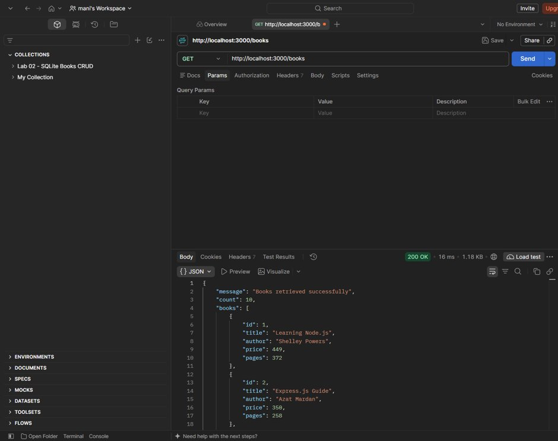  
*GET `/books` – Retrieves all 10 seeded technical books with HTTP `200 OK`.*

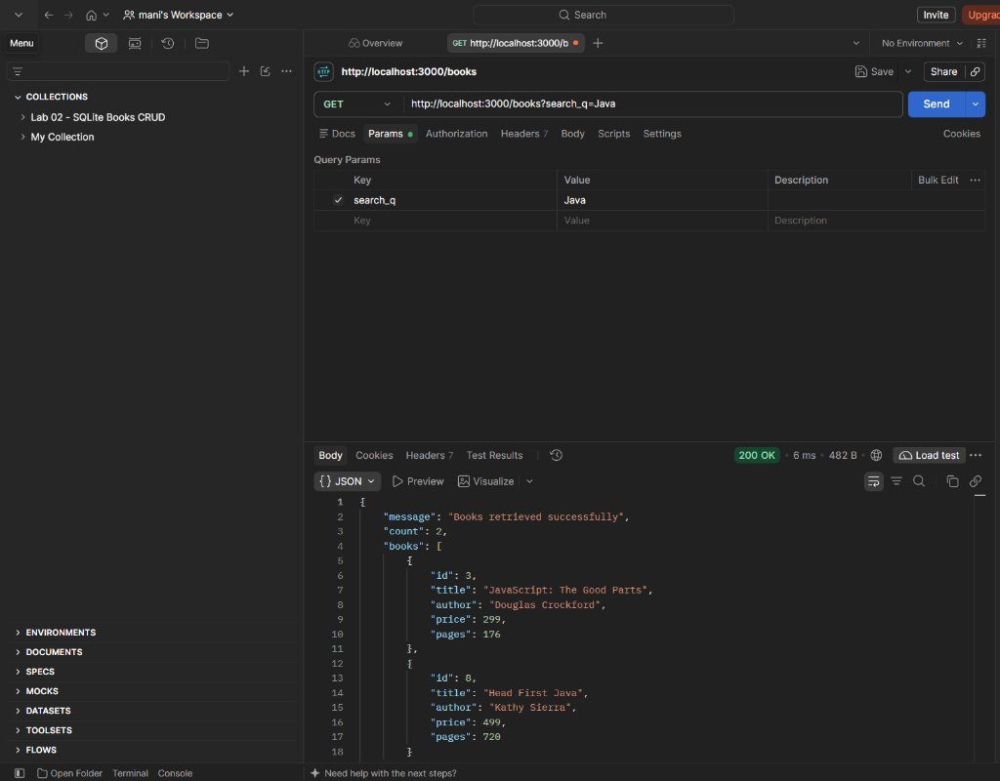  
*GET `/books?search_q=Java` – Returns matching books containing "Java" with HTTP `200 OK`.*

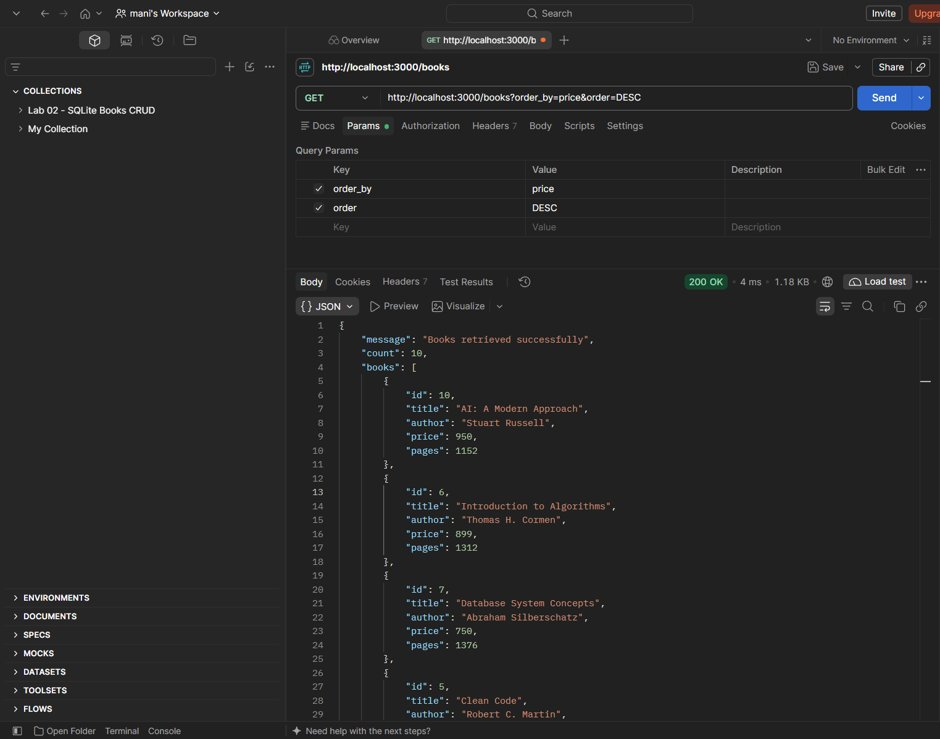  
*GET `/books?order_by=price&order=DESC` – Returns books sorted by price descending with HTTP `200 OK`.*

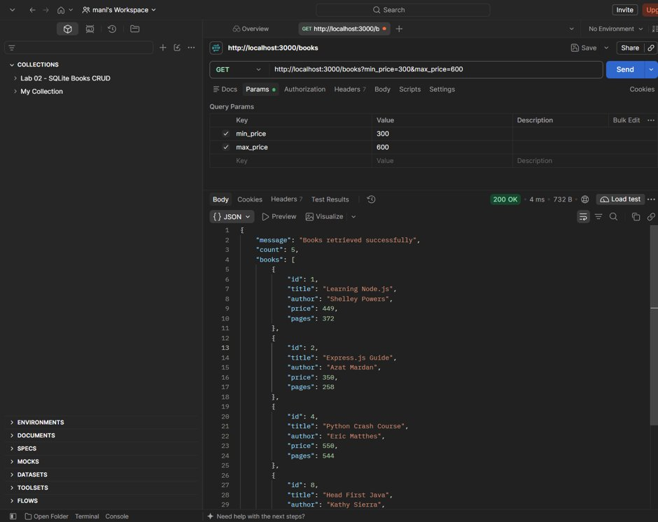  
*GET `/books?min_price=300&max_price=600` – Filters books priced between ₹300 and ₹600 with HTTP `200 OK`.*

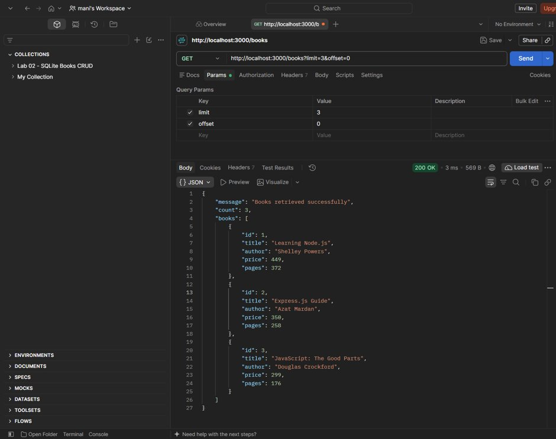  
*GET `/books?limit=3&offset=0` – Returns the first 3 book records with HTTP `200 OK`.*

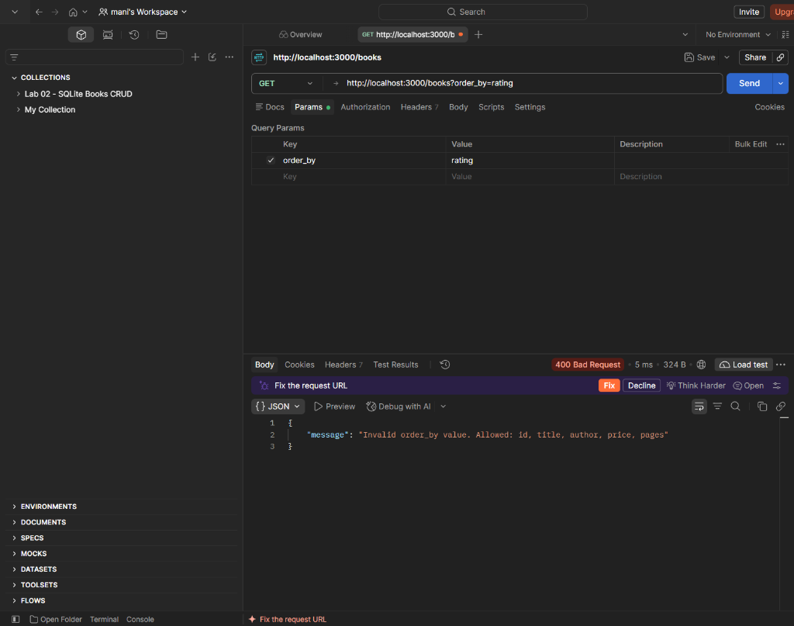  
*GET `/books?order_by=rating` – Rejects disallowed column names with HTTP `400 Bad Request`.*

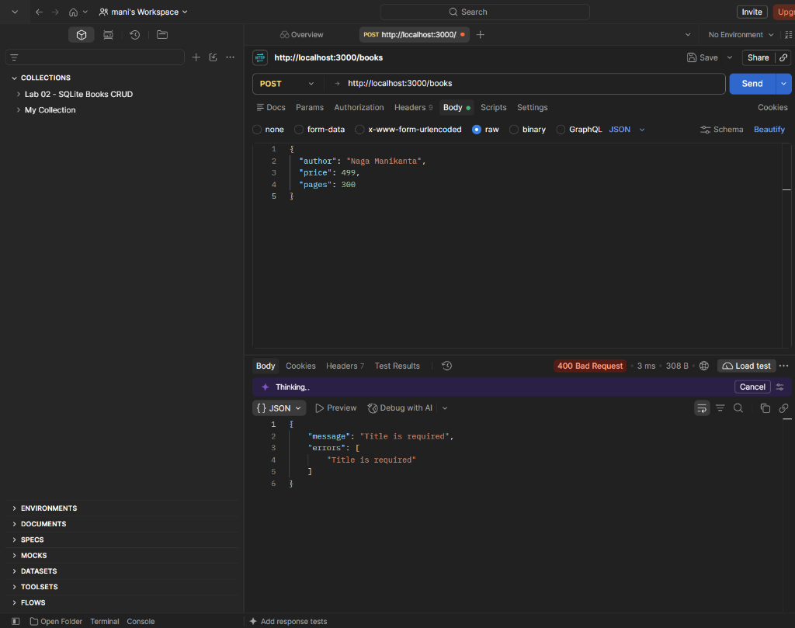  
*POST `/books` – Rejects requests missing mandatory `title` with HTTP `400 Bad Request`.*

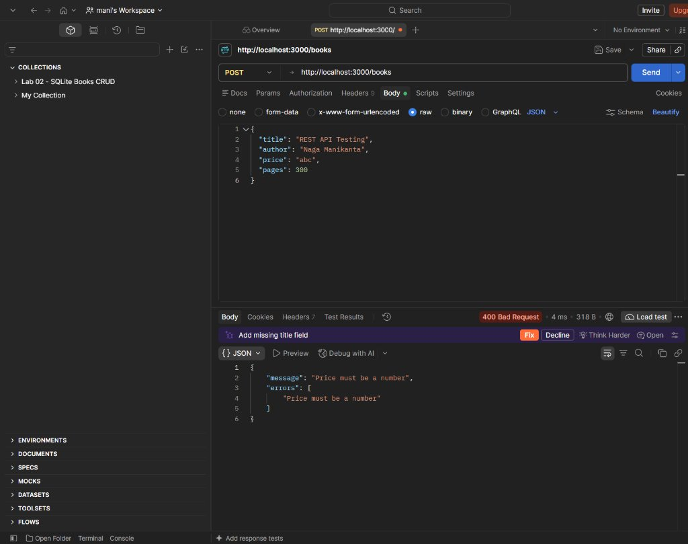  
*POST `/books` – Rejects non-numeric price data types with HTTP `400 Bad Request`.*

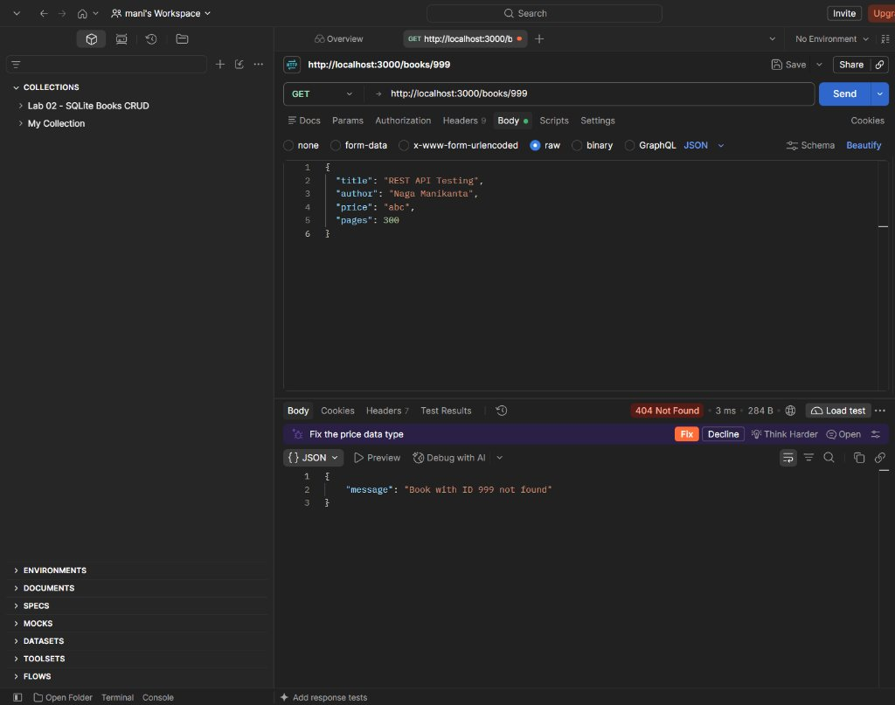  
*GET `/books/999` – Returns entity not found error with HTTP `404 Not Found`.*

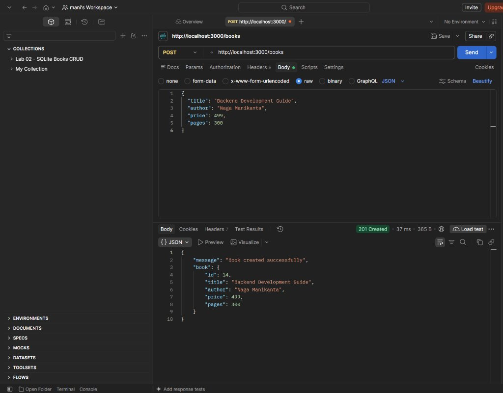  
*POST `/books` – Successfully creates a new book record and returns HTTP `201 Created`.*

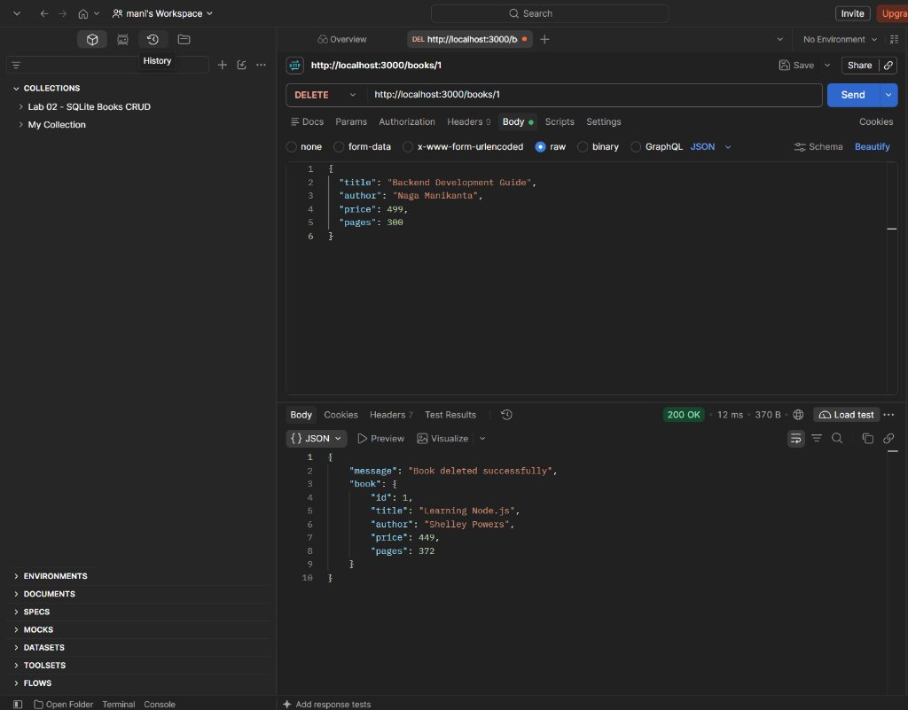  
*DELETE `/books/1` – Successfully deletes an existing book by ID with HTTP `200 OK`.*

---

## Project Structure Overview

```text
backend-development-fundamentals-labs-2/
│
├── lab-01/                              # Lab 1: Node.js & Express Server
│   ├── screenshots/
│   │   ├── home.png
│   │   ├── about.png
│   │   ├── time.png
│   │   └── 404-not-found.png
│   ├── .gitignore
│   ├── README.md
│   ├── app.js
│   ├── server.js
│   ├── package.json
│   ├── package-lock.json
│   └── test-api.js
│
├── lab-02/                              # Lab 2: SQLite Database & CRUD Routes
│   ├── LAB 2/
│   │   ├── database-verification.png
│   │   ├── delete-book.png
│   │   ├── get-all-books.png
│   │   ├── get-book-by-id.png
│   │   ├── post-add-book.png
│   │   └── put-update-book.png
│   ├── .gitignore
│   ├── README.md
│   ├── app.js
│   ├── initDB.sql
│   ├── package.json
│   ├── package-lock.json
│   ├── test-api.js
│   └── verify-db.js
│
├── lab-03/                              # Lab 3: REST API, Query Params & Validation
│   ├── screenshots/
│   │   ├── .gitkeep
│   │   ├── delete-book.png
│   │   ├── filter-by-price-range.png
│   │   ├── get-all-books.png
│   │   ├── get-book-not-found.png
│   │   ├── invalid-query-param.png
│   │   ├── pagination-limit-3-offset-0.png
│   │   ├── post-create-book.png
│   │   ├── post-invalid-price.png
│   │   ├── post-missing-title.png
│   │   ├── search-query-java.png
│   │   └── sort-by-price-desc.png
│   ├── .gitignore
│   ├── README.md
│   ├── app.js
│   ├── database.js
│   ├── initDB.sql
│   ├── package.json
│   └── package-lock.json
│
├── .gitignore
└── README.md                            # Main Coursework Hub
```
