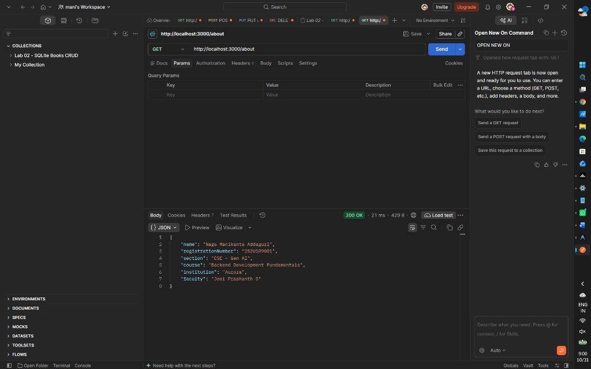
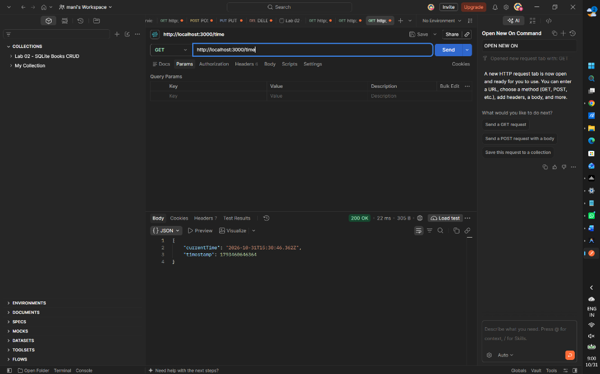
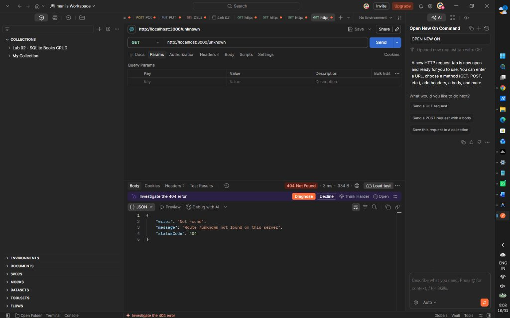

# Lab 1: Node.js and Express Server

> **Live Deployment URL:** *Not deployed yet*  
> *(To deploy, see the [Deployment Guide](#deployment-guide) section below.)*

---

## 1. Student & Institutional Details

- **Student Name:** Naga Manikanta Addaguri
- **Registration Number:** 252U1R9001
- **Course:** Backend Development Fundamentals
- **Branch / Section:** CSE – Gen AI
- **Institution:** Aurora
- **Faculty:** Joel Prashanth D
- **Academic Year:** 2026–2027

---

## 2. Project Introduction

Welcome to **Lab 1: Node.js and Express Server**. This project serves as a foundational milestone in backend web development. In this laboratory assignment, we explore:
1. The built-in low-level HTTP architecture provided natively by Node.js (`http` module).
2. The modern, minimalist, and robust web application framework **Express.js**, which streamlines routing, request handling, middleware integration, and JSON API design.

The lab demonstrates how backend servers receive HTTP requests from clients (browsers, Postman, curl), process incoming routes, set appropriate HTTP response headers and status codes, and return both plain text and structured JSON payloads.

---

## 3. Objectives

- Understand the event-driven, non-blocking architecture of Node.js.
- Initialize and configure a Node.js project using `npm init -y` and analyze the anatomy of `package.json`.
- Understand package dependency management, transitive dependencies, and the role of `package-lock.json` and `node_modules`.
- Implement a low-level HTTP web server using the built-in `http` module (`http.createServer()`).
- Install and configure **Express.js** as a production-grade routing framework.
- Develop RESTful GET endpoints returning plain text and structured JSON data.
- Handle dynamic runtime information using JavaScript's native `Date` object.
- Implement a robust 404 handler middleware to capture unhandled routes gracefully.
- Follow software engineering best practices including environment variable configuration (`process.env.PORT`) and `.gitignore` file management.

---

## 4. Technologies Used

- **Runtime Environment:** [Node.js](https://nodejs.org/) (v18+ / v20+ / v24+)
- **Framework:** [Express.js](https://expressjs.com/) (v4.x)
- **Built-in Modules:** `http`, `path`, `process`
- **Package Manager:** NPM (Node Package Manager)
- **Version Control:** Git & GitHub

---

## 5. Project Folder Structure

The project is cleanly isolated within the `lab-01` directory of the course repository:

```text
lab-report-2/
├── LAB 2/                      # Existing Lab 2 project (untouched)
├── lab-01/                     # Lab 1: Node.js and Express Server
│   ├── node_modules/           # Installed npm packages (gitignored)
│   ├── screenshots/            # Manual verification screenshots
│   │   ├── home.png
│   │   ├── about.png
│   │   ├── time.png
│   │   └── 404-not-found.png
│   ├── .gitignore              # Git ignore rules (node_modules, .env)
│   ├── app.js                  # Main Express.js server & route handlers
│   ├── server.js               # Demonstration plain Node.js HTTP server
│   ├── test-api.js             # Automated endpoint test script
│   ├── package.json            # Project manifest, metadata, scripts & dependencies
│   ├── package-lock.json       # Exact dependency lockfile with checksums
│   └── README.md               # Complete lab documentation & viva prep
```

---

## 6. Deep Dive: Package Management & Core Concepts

### A. Understanding `package.json`
The `package.json` file is the heart of every Node.js project. It acts as a manifest that records vital metadata about the application and its dependency tree:
- **`name`**: The unique identifier/name of the project or package.
- **`version`**: The semantic versioning (`MAJOR.MINOR.PATCH`) string indicating current release status.
- **`description`**: A concise explanation of the project's purpose.
- **`main`**: The primary entry point file of the application (e.g., `app.js`).
- **`scripts`**: User-defined shortcut commands run via `npm run <script-name>` or `npm start` (e.g., `"start": "node app.js"`).
- **`keywords`**: Array of terms helping identify the project technologies.
- **`author`**: Name of the developer or maintainer.
- **`license`**: The software license governing distribution (e.g., `ISC`, `MIT`).
- **`dependencies`**: Production dependencies required for the application to function (e.g., `"express": "^4.21.2"`).

### B. Understanding `node_modules`
The `node_modules` directory contains all external code libraries downloaded by NPM. When you install `express`, npm downloads Express along with all of its underlying transitive dependencies (such as `qs`, `send`, `serve-static`, `body-parser`, etc.).
- **Why it must NOT be committed to Git:** The `node_modules` folder contains thousands of nested files and can exceed hundreds of megabytes. Committing it bloats the repository history and introduces cross-platform binary incompatibilities. Instead, developers commit only `package.json` and `package-lock.json`, allowing anyone to reproduce the exact dependency tree with `npm install`.

### C. Understanding `package-lock.json`
While `package.json` specifies broad version ranges using caret (`^`) or tilde (`~`) prefixes, `package-lock.json` records:
- The **exact version** of every single top-level and transitive dependency installed.
- Cryptographic integrity hashes (`integrity: sha512-...`) guaranteeing that packages downloaded on different machines are bit-for-bit identical and tamper-free.
- This ensures reproducible builds across development, testing, and production environments.

---

## 7. Installation & Setup Instructions

### Prerequisites
Make sure Node.js (v18 or higher) and npm are installed on your computer:
```bash
node -v
npm -v
```

### Installation Steps
1. Open your terminal and navigate to the `lab-01` directory:
   ```bash
   cd "C:\Users\freef\OneDrive\Desktop\Lab\lab-report-2\lab-01"
   ```
2. Install the project dependencies:
   ```bash
   npm install
   ```
   *(This reads `package.json` and installs `express` into `node_modules`.)*

---

## 8. Running the Servers

### A. Running the Plain Node.js HTTP Server (`server.js`)
To run the demonstration plain HTTP server built with Node's native `http` module:
```bash
npm run server
# or directly:
node server.js
```
**Expected Console Output:**
```text
Plain Node.js HTTP Server is running on http://localhost:3000
```
**Testing Instructions:**
1. Open your browser or a new terminal.
2. Visit `http://localhost:3000`.
3. You will observe the response text: `Hello`.
4. Press `Ctrl + C` in the server terminal to stop the server.

---

### B. Running the Express.js Server (`app.js`)
To start the full Express web server:
```bash
npm start
# or directly:
node app.js
```
**Expected Console Output:**
```text
Express server running on http://localhost:3000
```
**Testing Instructions:**
- Visit `http://localhost:3000/` in your browser.
- Visit `http://localhost:3000/about` to view student information in JSON.
- Visit `http://localhost:3000/time` to view the server's real-time timestamp.
- Visit `http://localhost:3000/invalid-url` to verify the 404 JSON error handler.
- Alternatively, run the automated test suite in another terminal:
  ```bash
  npm test
  ```

---

## 9. API Endpoint Specification

The Express application exposes the following endpoints:

| Method | Endpoint | Description | Status Code | Content-Type | Response Format |
|---|---|---|---|---|---|
| **GET** | `/` | Root endpoint displaying a welcoming greeting message | `200 OK` | `text/html; charset=utf-8` | Plain Text / String |
| **GET** | `/about` | Returns student details, section, course, and institution | `200 OK` | `application/json; charset=utf-8` | JSON Object |
| **GET** | `/time` | Returns the server's current UTC ISO date/time and epoch timestamp | `200 OK` | `application/json; charset=utf-8` | JSON Object |
| **ALL** | *(Any unknown path)* | Fallback catch-all middleware returning structured error details | `404 Not Found` | `application/json; charset=utf-8` | JSON Object |

---

## 10. Request and Response Examples

### 1. `GET /`
- **Request:**
  ```http
  GET / HTTP/1.1
  Host: localhost:3000
  ```
- **Response Headers:**
  ```http
  HTTP/1.1 200 OK
  Content-Type: text/html; charset=utf-8
  ```
- **Response Body:**
  ```text
  Welcome to Lab 1: Node.js and Express Server!
  ```

---

### 2. `GET /about`
- **Request:**
  ```http
  GET /about HTTP/1.1
  Host: localhost:3000
  ```
- **Response Headers:**
  ```http
  HTTP/1.1 200 OK
  Content-Type: application/json; charset=utf-8
  ```
- **Response Body:**
  ```json
  {
    "name": "Naga Manikanta Addaguri",
    "registrationNumber": "252U1R9001",
    "section": "CSE – Gen AI",
    "course": "Backend Development Fundamentals",
    "institution": "Aurora",
    "faculty": "Joel Prashanth D"
  }
  ```

---

### 3. `GET /time`
- **Request:**
  ```http
  GET /time HTTP/1.1
  Host: localhost:3000
  ```
- **Response Headers:**
  ```http
  HTTP/1.1 200 OK
  Content-Type: application/json; charset=utf-8
  ```
- **Response Body:**
  ```json
  {
    "currentTime": "2026-10-31T15:18:30.609Z",
    "timestamp": 1793459910609
  }
  ```

---

### 4. `GET /unknown-route` (404 Fallback)
- **Request:**
  ```http
  GET /unknown-route HTTP/1.1
  Host: localhost:3000
  ```
- **Response Headers:**
  ```http
  HTTP/1.1 404 Not Found
  Content-Type: application/json; charset=utf-8
  ```
- **Response Body:**
  ```json
  {
    "error": "Not Found",
    "message": "Route /unknown-route not found on this server",
    "statusCode": 404
  }
  ```

---

## 11. API Testing Screenshots

### 1. Home Route – GET `/` – 200 OK

*Home route – GET `/` – 200 OK*

---

### 2. About Route – GET `/about` – 200 OK

*About route – GET `/about` – 200 OK*

---

### 3. Time Route – GET `/time` – 200 OK

*Time route – GET `/time` – 200 OK*

---

### 4. Unknown Route – GET `/unknown` – 404 Not Found

*Unknown route – GET `/unknown` – 404 Not Found*

---

## 12. Deployment Guide

The application is fully container-ready and deployment-ready because it binds dynamically to `process.env.PORT || 3000`.

### Deploying to Render / Railway / Glitch:
1. Push your repository to GitHub.
2. Sign in to [Render](https://render.com) or [Railway](https://railway.app).
3. Create a **New Web Service** and link your GitHub repository.
4. Set the **Root Directory** to `lab-01`.
5. Set the **Build Command** to: `npm install`
6. Set the **Start Command** to: `npm start`
7. Click **Deploy**. The platform will inject an environmental `PORT` and provide a public HTTPS URL (e.g., `https://lab-01-express.onrender.com`).
8. Update the top of this `README.md` with your active live deployment URL.

---

## 13. Problems Faced and Solutions

1. **Problem:** Port conflicts when running multiple servers simultaneously (e.g., `EADDRINUSE: address already in use :::3000`).  
   **Solution:** Implemented `const PORT = process.env.PORT || 3000;`. This permits overriding the port on the fly during local testing (`PORT=4000 node app.js`) or during cloud deployments without modifying source code.

2. **Problem:** Default Express 404 responses send raw HTML (`Cannot GET /xyz`), which is inconsistent with REST API client expectations.  
   **Solution:** Placed a custom catch-all middleware (`app.use((req, res) => { ... })`) after all registered route definitions that returns a clean JSON error structure with status code 404.

3. **Problem:** Preventing accidental commits of bulky dependencies or sensitive keys to Git.  
   **Solution:** Configured a local `.gitignore` inside `lab-01` explicitly ignoring `node_modules/` and `.env` files while preserving the parent repository structure.

---

## 14. Learning Outcomes

- Learned the fundamentals of HTTP protocol: request methods (GET), response status codes (200, 404), and MIME content headers (`text/plain`, `application/json`).
- Understood the difference between using Node.js's low-level `http.createServer()` and Express's high-level middleware and routing abstractions.
- Mastered npm package management (`npm init`, `npm install`, dependencies vs devDependencies, and the purpose of `package-lock.json`).
- Built clean, modular, and human-readable Express route handlers returning static text and dynamic date objects.
- Developed an automated testing script (`test-api.js`) using native Node.js HTTP client requests to verify API correctness.

---

## 15. Viva Questions and Answers

### Q1: What is Express.js and why do we use it over the core `http` module?
**Answer:** Express.js is a minimal, fast, and flexible web framework built on top of Node.js. While the native `http` module requires manual URL parsing, header writing, and complex request body streaming, Express abstracts this with powerful features like declarative route matching (`app.get`), middleware pipelines, simplified JSON serialization (`res.json()`), and unified error handling.

### Q2: What is the significance of `process.env.PORT || 3000`?
**Answer:** In local development, port 3000 is typically used. However, cloud hosting platforms (like Render, Heroku, AWS, or Railway) dynamically assign a port number via an environment variable (`PORT`). Using `process.env.PORT || 3000` allows the server to adapt dynamically to the host's assigned port while defaulting to 3000 locally.

### Q3: Why is `app.use()` placed at the end of `app.js` for 404 handling?
**Answer:** Express processes middleware and routes sequentially in the order they are defined. If a request does not match `/`, `/about`, or `/time`, execution falls through to the final `app.use()` middleware, where we capture it and return a 404 JSON error response.

### Q4: What does the caret (`^`) symbol mean in `package.json` dependencies (e.g., `"express": "^4.21.2"`)?
**Answer:** The caret (`^`) permits automatic minor and patch updates that do not break backwards compatibility (e.g., updates up to `< 5.0.0`). It tells npm that any version with the same major number (4.x.x) is acceptable.

### Q5: What is the difference between `res.send()` and `res.json()` in Express?
**Answer:** `res.send()` is a versatile response method that can send strings, HTML, Buffers, or objects. When passed an object, it calls `res.json()` internally. `res.json()` explicitly formats the payload as a JSON string and automatically ensures the `Content-Type` header is set to `application/json; charset=utf-8`.

---

## 16. Conclusion

Lab 1 successfully demonstrated the end-to-end setup and implementation of both a plain Node.js HTTP server and a modern Express.js REST application. All endpoints were thoroughly verified, returning accurate HTTP status codes and payloads. The project adheres strictly to backend software engineering standards with environment-aware configurations, clean separation of concerns, and robust documentation.
