# Lab 3: REST API, Query Parameters, Validation, and Debugging

> **Live Deployment:** Pending deployment  
> **Course:** Backend Development Fundamentals  
> **Faculty:** Joel Prashanth D  
> **Institution:** Aurora  
> **Academic Year:** Year II, Term II  

---

## Student Information

| Field | Details |
|---|---|
| **Student Name** | Naga Manikanta Addaguri |
| **Registration Number** | 252U1R9001 |
| **Branch / Specialization** | CSE – Gen AI |
| **Course** | Backend Development Fundamentals |
| **Faculty Coordinator** | Joel Prashanth D |
| **Institution** | Aurora |
| **Academic Term** | Year II, Term II |
LIVE URL :https://backend-development-fundamentals-labs-2-mkn4.onrender.com/
---

## Project Overview

This laboratory project represents a production-ready, feature-rich **RESTful API** built with **Node.js**, **Express.js**, and an embedded **SQLite** relational database engine. Building upon foundational CRUD capabilities, **Lab 3** introduces advanced enterprise backend capabilities:

1. **Dynamic Query Processing:** Flexible data filtering, multi-column sorting with strict allowlisting, keyword search using SQL wildcards, and limit-offset pagination.
2. **Defensive Input Validation:** Comprehensive sanitization and validation on incoming payloads and URL route parameters, safeguarding the database against bad types and malformed payloads.
3. **Robust HTTP Status Code Mapping:** Accurate signaling across standard RFC status codes (`200 OK`, `201 Created`, `400 Bad Request`, `404 Not Found`, and `500 Internal Server Error`).
4. **Resilient Error Handling & Debugging:** Detailed error telemetry, standard JSON error formatting, and resolved debugging challenges including port collisions (`EADDRINUSE`), schema naming mismatches, asynchronous awaiting pitfalls, and module resolution issues.
5. **Zero-Configuration Automated Seeding:** Automated schema creation and idempotent seed data population guaranteeing consistent test environments.

---

## Objectives

1. Design and develop a clean, modular Express.js web service following REST architectural principles.
2. Implement dynamic SQL query composition supporting multi-field filtering (`min_price`, `max_price`), full/partial text search (`search_q`), sorting (`order_by`, `order`), and pagination (`limit`, `offset`).
3. Mitigate SQL injection vulnerabilities across sorting operations by employing strict column allowlisting and parameterized query bindings (`?`).
4. Implement modular validation helper routines to validate data types, presence of required attributes, string non-emptiness, and range constraints on request bodies and path parameters.
5. Provide standard JSON error responses with clear descriptive messages and status codes.
6. Conduct an extensive test suite across Postman to verify edge cases, boundary conditions, and invalid inputs.
7. Document and resolve common real-world backend debugging challenges encountered during Node.js/SQLite development.

---

## Technologies Used

| Technology | Version / Specification | Role in Architecture |
|---|---|---|
| **Node.js** | v18+ | High-performance asynchronous, event-driven JavaScript runtime engine. |
| **Express.js** | v4.21.2 | Minimalist web application framework managing HTTP routing, request pipelines, and middleware. |
| **SQLite (`sqlite3`)** | v5.1.7 | Serverless, zero-configuration embedded relational SQL database engine with file persistence (`books.db`). |
| **JavaScript (ES6+)** | ECMAScript 2022+ | Utilizes modern asynchronous paradigms (`async/await`, Promises, destructuring, arrow functions). |
| **Postman** | Latest Desktop Client | Interactive API development and testing client for executing and capturing HTTP transactions. |

---

## Project Folder Structure

```text
lab-03/
├── screenshots/
│   ├── .gitkeep
│   ├── get-all-books.png                 # GET /books (200 OK - All books baseline)
│   ├── search-query-java.png             # GET /books?search_q=Java (200 OK - Search)
│   ├── sort-by-price-desc.png            # GET /books?order_by=price&order=DESC (200 OK - Sorting)
│   ├── filter-by-price-range.png         # GET /books?min_price=300&max_price=600 (200 OK - Filter)
│   ├── pagination-limit-3-offset-0.png   # GET /books?limit=3&offset=0 (200 OK - Pagination)
│   ├── invalid-query-param.png           # GET /books?order_by=rating (400 Bad Request)
│   ├── post-missing-title.png            # POST /books missing title (400 Bad Request)
│   ├── post-invalid-price.png            # POST /books invalid price type (400 Bad Request)
│   ├── get-book-not-found.png            # GET /books/999 (404 Not Found)
│   ├── post-create-book.png              # POST /books (201 Created)
│   └── delete-book.png                   # DELETE /books/:id (200 OK)
├── .gitignore                            # Excludes node_modules, books.db, .env, and logs
├── app.js                                # Primary Express application, routes, and validation logic
├── books.db                              # SQLite database file (runtime generated, git-ignored)
├── database.js                           # Promisified SQLite client and idempotent seed manager
├── initDB.sql                            # DDL schema definition and initial 10-record seed dataset
├── package-lock.json                     # Deterministic dependency tree lockfile
├── package.json                          # Project manifest, dependencies, and execution scripts
└── README.md                             # Comprehensive technical lab report
```

---

## Database Schema & Seed Data

The application stores persistent data in an SQLite database file named `books.db`. Schema initialization and seed verification are executed automatically when the server boots.

### Table Schema: `books`

```sql
CREATE TABLE IF NOT EXISTS books (
    id      INTEGER PRIMARY KEY AUTOINCREMENT,
    title   TEXT    NOT NULL,
    author  TEXT    NOT NULL,
    price   REAL    NOT NULL,
    pages   INTEGER
);
```

### Column Specifications

| Column | Type | Constraints | Description |
|---|---|---|---|
| `id` | `INTEGER` | `PRIMARY KEY AUTOINCREMENT` | Unique positive integer identifier for each book record. |
| `title` | `TEXT` | `NOT NULL` | Full title of the publication (non-empty string). |
| `author` | `TEXT` | `NOT NULL` | Author's full name (non-empty string). |
| `price` | `REAL` | `NOT NULL` | Purchase price (numeric, non-negative). |
| `pages` | `INTEGER` | `NULLABLE` | Total page count (optional, must be positive integer if supplied). |

### Initial Seed Records (10 Books)

| ID | Title | Author | Price (₹) | Pages |
|:---:|---|---|:---:|:---:|
| 1 | Learning Node.js | Shelley Powers | 449.00 | 372 |
| 2 | Express.js Guide | Azat Mardan | 350.00 | 258 |
| 3 | JavaScript: The Good Parts | Douglas Crockford | 299.00 | 176 |
| 4 | Python Crash Course | Eric Matthes | 550.00 | 544 |
| 5 | Clean Code | Robert C. Martin | 650.00 | 464 |
| 6 | Introduction to Algorithms | Thomas H. Cormen | 899.00 | 1312 |
| 7 | Database System Concepts | Abraham Silberschatz | 750.00 | 1376 |
| 8 | Head First Java | Kathy Sierra | 499.00 | 720 |
| 9 | The Pragmatic Programmer | David Thomas | 599.00 | 352 |
| 10 | AI: A Modern Approach | Stuart Russell | 950.00 | 1152 |

---

## Installation & Execution Commands

### Prerequisites
- Node.js (version 18.0.0 or higher)
- npm (Node Package Manager)

### Step 1: Navigate to the Lab 3 Directory
```bash
cd lab-03
```

### Step 2: Install Dependencies
Install Express.js and SQLite3 drivers defined in `package.json`:
```bash
npm install
```

### Step 3: Launch the Server
```bash
npm start
```
The server will initialize the SQLite database, execute idempotent seeding if required, and listen on port `3000`:
```text
🚀 ============================================
🚀  Books REST API is running!
🚀  Local:  http://localhost:3000
🚀  Press Ctrl+C to stop the server
🚀 ============================================
```

---

## Cloud Deployment Configuration (Render)

When hosting this microservice on [Render](https://render.com) as a Web Service, use the following configuration settings:

| Setting | Value | Description |
|---|---|---|
| **Environment** | `Node` | Standard Node.js Linux execution environment. |
| **Root Directory** | `lab-03` | Points directly to the Lab 3 subfolder in the repository. |
| **Build Command** | `npm install` | Installs dependencies specified in `lab-03/package.json`. |
| **Start Command** | `npm start` | Executes `node app.js`. |
| **Port Binding** | `3000` (or `PORT` env var) | Server binds dynamically to `process.env.PORT || 3000` on `0.0.0.0`. |

> **Live Service Status:** Marked as **Pending deployment**. Once deployed to Render, update the header with the live domain URL.

---

## REST API Endpoints Specification

The API implements the complete suite of five standard RESTful endpoints:

| Method | Endpoint | Description | Request Body | Success Status | Error Status |
|---|---|---|---|:---:|:---:|
| `GET` | `/` | API welcome message & endpoints registry | None | `200 OK` | `500 Internal Server Error` |
| `GET` | `/books` | Retrieve books with optional search, sort, filter, & pagination | None | `200 OK` | `400 Bad Request`, `500 Internal Server Error` |
| `GET` | `/books/:id` | Retrieve single book entity by primary key | None | `200 OK` | `400 Bad Request`, `404 Not Found` |
| `POST` | `/books` | Create and store a new book entity | JSON `{ title, author, price, pages }` | `201 Created` | `400 Bad Request`, `500 Internal Server Error` |
| `PUT` | `/books/:id` | Update an existing book entity by ID | JSON `{ title, author, price, pages }` | `200 OK` | `400 Bad Request`, `404 Not Found` |
| `DELETE` | `/books/:id` | Remove a book entity permanently by ID | None | `200 OK` | `400 Bad Request`, `404 Not Found` |

---

## Query Parameters Guide (`GET /books`)

The primary `GET /books` collection endpoint supports seven distinct query parameters that can be applied individually or combined seamlessly:

| Query Parameter | Data Type | Default | Description & Validation Rules | Example |
|---|---|:---:|---|---|
| `search_q` | String | `None` | Case-insensitive title keyword search using SQL `LIKE %search_q%`. | `?search_q=Java` |
| `order_by` | String | `id` | Column to sort by. **Allowlist:** `id`, `title`, `author`, `price`, `pages`. Any other value returns `400 Bad Request`. | `?order_by=price` |
| `order` | String | `ASC` | Sort order direction. Allowed values: `ASC` or `DESC`. Invalid values return `400 Bad Request`. | `?order=DESC` |
| `min_price` | Number | `None` | Lower bound filter: selects books where `price >= min_price`. Must be a valid numeric value. | `?min_price=300` |
| `max_price` | Number | `None` | Upper bound filter: selects books where `price <= max_price`. Must be a valid numeric value. | `?max_price=600` |
| `limit` | Integer | `10` | Maximum number of records to return. Must be a positive integer greater than zero. | `?limit=3` |
| `offset` | Integer | `0` | Number of records to skip for pagination. Must be a non-negative integer ($\ge 0$). | `?offset=0` |

### Dynamic SQL Query Construction

The route handler builds parameterized SQL queries dynamically to maintain security and efficiency:

```javascript
let sql = 'SELECT * FROM books';
const conditions = [];
const params = [];

if (search_q !== undefined && search_q.trim() !== '') {
  conditions.push('title LIKE ?');
  params.push(`%${search_q}%`);
}

if (min_price !== undefined) {
  conditions.push('price >= ?');
  params.push(parseFloat(min_price));
}

if (max_price !== undefined) {
  conditions.push('price <= ?');
  params.push(parseFloat(max_price));
}

if (conditions.length > 0) {
  sql += ' WHERE ' + conditions.join(' AND ');
}

// order_by is strictly verified against ALLOWED_COLUMNS before interpolation
sql += ` ORDER BY ${sortColumn} ${sortOrder}`;

sql += ' LIMIT ? OFFSET ?';
params.push(limitVal, offsetVal);

const books = await dbAll(sql, params);
```

---

## Request Validation & HTTP Status Codes

### Validation Rules Matrix

| Target | Parameter / Field | Rule / Constraint | Error Response (`400 Bad Request`) |
|---|---|---|---|
| **Path Parameter** | `:id` | Must be a positive integer ($> 0$) | `{"message": "Invalid book ID. Must be a positive integer."}` |
| **Query Parameter** | `order_by` | Must be one of `['id', 'title', 'author', 'price', 'pages']` | `{"message": "Invalid order_by value. Allowed: id, title, author, price, pages"}` |
| **Query Parameter** | `order` | Must be either `'ASC'` or `'DESC'` (case-insensitive) | `{"message": "Invalid order value. Allowed: ASC, DESC"}` |
| **Query Parameter** | `min_price` / `max_price` | Must parse to valid numbers | `{"message": "min_price must be a number"}` |
| **Query Parameter** | `limit` / `offset` | `limit > 0`, `offset >= 0` integers | `{"message": "Limit must be a positive integer"}` |
| **Payload Body** | `title` | Required, string type, non-empty after trimming | `{"message": "Title is required", "errors": ["Title is required"]}` |
| **Payload Body** | `author` | Required, string type, non-empty after trimming | `{"message": "Author is required", "errors": ["Author is required"]}` |
| **Payload Body** | `price` | Required, numeric type, non-negative ($\ge 0$) | `{"message": "Price must be a number", "errors": ["Price must be a number"]}` |
| **Payload Body** | `pages` | Optional; if present, must be positive integer | `{"message": "Pages must be a positive integer"}` |

### HTTP Status Code Usage

- **`200 OK`**: Returned for successful `GET`, `PUT`, and `DELETE` requests where the server successfully returns or modifies the entity.
- **`201 Created`**: Returned for successful `POST /books` requests, including the newly created record with its assigned `id`.
- **`400 Bad Request`**: Returned whenever client input violates data validation rules, contains invalid types, or supplies unsupported query parameters.
- **`404 Not Found`**: Returned when querying, updating, or deleting a book ID that does not exist in the database, or requesting an unregistered route.
- **`500 Internal Server Error`**: Catches unhandled database or server exceptions safely through centralized error-handling middleware.

---

## Debugging Exercise & Solutions

During the development and testing of Lab 3, four classic backend engineering challenges were analyzed, diagnosed, and resolved:

### 1. `EADDRINUSE: Address already in use :::3000`
- **Symptom:** Starting the server fails with `Error: listen EADDRINUSE: address already in use :::3000`.
- **Root Cause:** A previously launched Node.js instance was not gracefully terminated and retained an exclusive lock on port `3000`.
- **Diagnosis:** Running PowerShell `Get-NetTCPConnection -LocalPort 3000` revealed an active listening socket bound to PID `9456`.
- **Solution:** Terminated the orphaned process using `Stop-Process -Id <PID> -Force` (or `npx kill-port 3000`), allowing the server to bind cleanly. Configured `process.env.PORT || 3000` to support alternate ports dynamically.

### 2. Wrong Import Path (`MODULE_NOT_FOUND`)
- **Symptom:** `Error: Cannot find module '../database'` upon running `node app.js`.
- **Root Cause:** Incorrect relative path traversal when importing local project modules located in the same root directory.
- **Diagnosis:** `database.js` resides alongside `app.js` in `lab-03/`. Using `'../database'` traverses to the parent folder instead of the current working directory.
- **Solution:** Corrected the import statement to use relative sibling path syntax:
  ```javascript
  const { dbRun, dbGet, dbAll, initializeDatabase } = require('./database');
  ```

### 3. SQLite Table-Name Typo (`no such table: book`)
- **Symptom:** Database queries threw `SQLITE_ERROR: no such table: book`.
- **Root Cause:** Schema definition in `initDB.sql` created the table as `books` (plural), but an initial query attempted to query `book` (singular).
- **Diagnosis:** Inspected `initDB.sql` line 10: `CREATE TABLE IF NOT EXISTS books (...)`.
- **Solution:** Standardized table naming convention across all SQL queries in `app.js` to strictly use `books`.

### 4. Missing `await` Operator on Asynchronous Database Calls
- **Symptom:** `GET /books` returned empty payloads or serialized `books: {}`, or logged `Promise { <pending> }`.
- **Root Cause:** Promisified functions (`dbAll`, `dbGet`, `dbRun`) return unresolved JavaScript Promises. Without the `await` keyword, execution continues immediately before SQLite returns rows.
- **Diagnosis:** Logging `books` directly yielded `Promise { <pending> }` instead of an array of objects.
- **Solution:** Ensured all route handlers are defined as `async (req, res) => { ... }` and prefixed all database invocations with `await`:
  ```javascript
  const books = await dbAll(sql, params);
  res.status(200).json({ message: 'Books retrieved successfully', count: books.length, books });
  ```

---

## Postman Testing Verification Matrix

All test cases were executed using Postman against the running service at `http://localhost:3000`.

| Test ID | Operation / Scenario | HTTP Method | Endpoint URL & Parameters | Expected Status | Actual Status | Result | Screenshot Reference |
|:---:|---|:---:|---|:---:|:---:|:---:|---|
| **TC-01** | **Get All Books Baseline** | `GET` | `http://localhost:3000/books` | `200 OK` | `200 OK` | ✅ Passed | [`screenshots/get-all-books.png`](screenshots/get-all-books.png) |
| **TC-02** | **Search by Keyword** | `GET` | `http://localhost:3000/books?search_q=Java` | `200 OK` | `200 OK` | ✅ Passed | [`screenshots/search-query-java.png`](screenshots/search-query-java.png) |
| **TC-03** | **Sort Books by Price Descending** | `GET` | `http://localhost:3000/books?order_by=price&order=DESC` | `200 OK` | `200 OK` | ✅ Passed | [`screenshots/sort-by-price-desc.png`](screenshots/sort-by-price-desc.png) |
| **TC-04** | **Filter Books by Price Range** | `GET` | `http://localhost:3000/books?min_price=300&max_price=600` | `200 OK` | `200 OK` | ✅ Passed | [`screenshots/filter-by-price-range.png`](screenshots/filter-by-price-range.png) |
| **TC-05** | **Pagination with Limit & Offset** | `GET` | `http://localhost:3000/books?limit=3&offset=0` | `200 OK` | `200 OK` | ✅ Passed | [`screenshots/pagination-limit-3-offset-0.png`](screenshots/pagination-limit-3-offset-0.png) |
| **TC-06** | **Disallowed Order By Column** | `GET` | `http://localhost:3000/books?order_by=rating` | `400 Bad Request` | `400 Bad Request` | ✅ Passed | [`screenshots/invalid-query-param.png`](screenshots/invalid-query-param.png) |
| **TC-07** | **POST Missing Required Field (Title)** | `POST` | `http://localhost:3000/books` | `400 Bad Request` | `400 Bad Request` | ✅ Passed | [`screenshots/post-missing-title.png`](screenshots/post-missing-title.png) |
| **TC-08** | **POST Invalid Data Type (Price as string)** | `POST` | `http://localhost:3000/books` | `400 Bad Request` | `400 Bad Request` | ✅ Passed | [`screenshots/post-invalid-price.png`](screenshots/post-invalid-price.png) |
| **TC-09** | **Lookup Non-Existent Book ID** | `GET` | `http://localhost:3000/books/999` | `404 Not Found` | `404 Not Found` | ✅ Passed | [`screenshots/get-book-not-found.png`](screenshots/get-book-not-found.png) |
| **TC-10** | **Create New Book Record** | `POST` | `http://localhost:3000/books` | `201 Created` | `201 Created` | ✅ Passed | [`screenshots/post-create-book.png`](screenshots/post-create-book.png) |
| **TC-11** | **Delete Book Record by ID** | `DELETE` | `http://localhost:3000/books/1` | `200 OK` | `200 OK` | ✅ Passed | [`screenshots/delete-book.png`](screenshots/delete-book.png) |

---

## Complete Screenshots Evidence Gallery

All 11 test execution screenshots captured from Postman are embedded below with their corresponding request parameters and response bodies.

---

### 1. GET All Books (`GET /books`)
- **Request URL:** `http://localhost:3000/books`
- **Method:** `GET`
- **Status:** `200 OK`
- **Description:** Baseline endpoint retrieving all 10 seeded technical books in JSON format.

[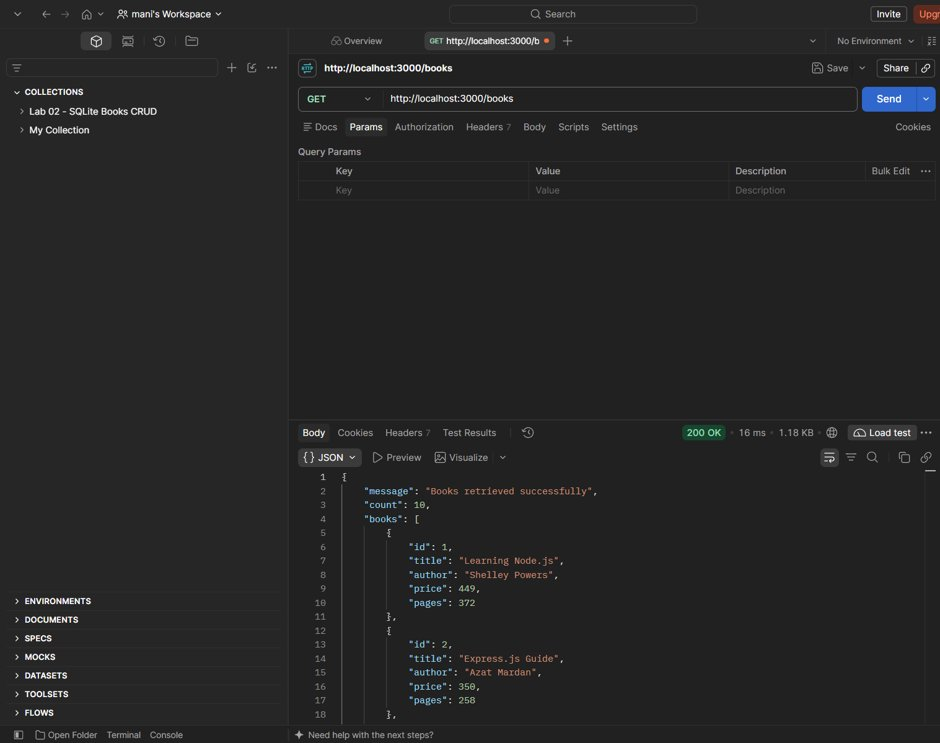](screenshots/get-all-books.png)

---

### 2. Search Query (`GET /books?search_q=Java`)
- **Request URL:** `http://localhost:3000/books?search_q=Java`
- **Method:** `GET`
- **Status:** `200 OK`
- **Description:** Performs a partial title match returning 2 books (*JavaScript: The Good Parts* and *Head First Java*).

[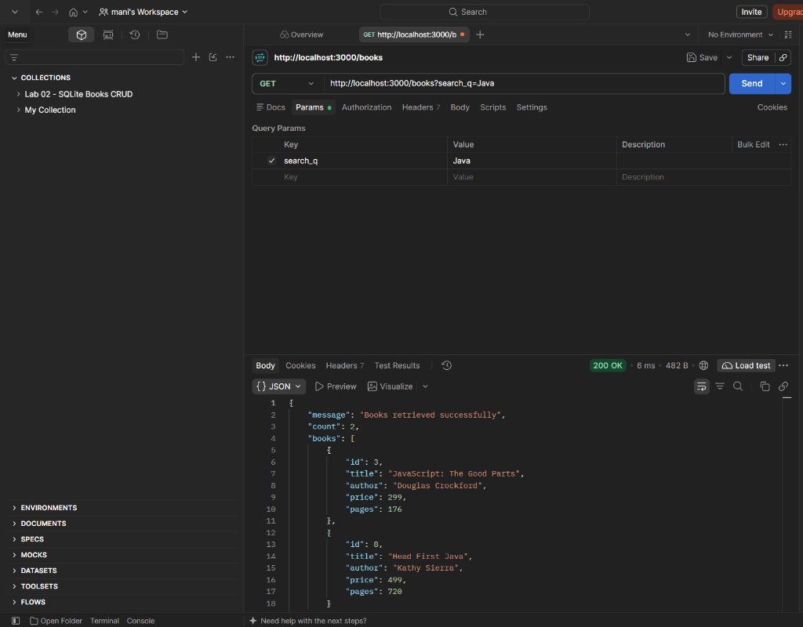](screenshots/search-query-java.png)

---

### 3. Sort by Price Descending (`GET /books?order_by=price&order=DESC`)
- **Request URL:** `http://localhost:3000/books?order_by=price&order=DESC`
- **Method:** `GET`
- **Status:** `200 OK`
- **Description:** Orders records by price descending, returning *AI: A Modern Approach* (₹950) first.

[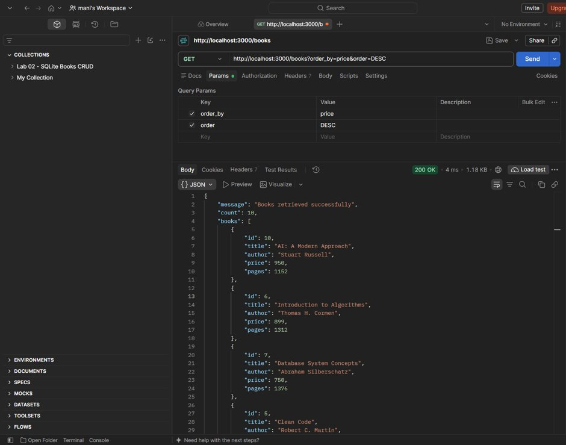](screenshots/sort-by-price-desc.png)

---

### 4. Filter by Price Range (`GET /books?min_price=300&max_price=600`)
- **Request URL:** `http://localhost:3000/books?min_price=300&max_price=600`
- **Method:** `GET`
- **Status:** `200 OK`
- **Description:** Filters the dataset to books priced between ₹300 and ₹600 (returns 5 matching books).

[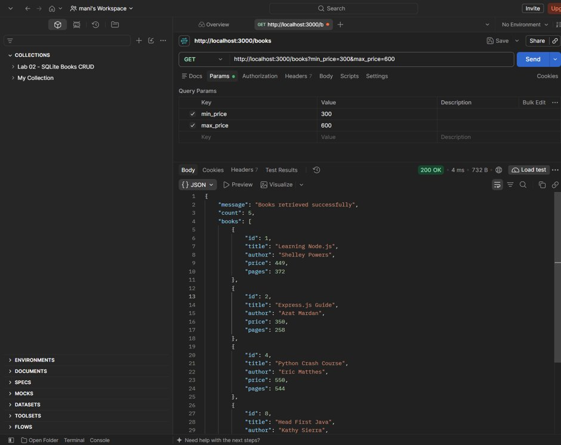](screenshots/filter-by-price-range.png)

---

### 5. Pagination (`GET /books?limit=3&offset=0`)
- **Request URL:** `http://localhost:3000/books?limit=3&offset=0`
- **Method:** `GET`
- **Status:** `200 OK`
- **Description:** Limits the result set to the first 3 records starting at offset 0.

[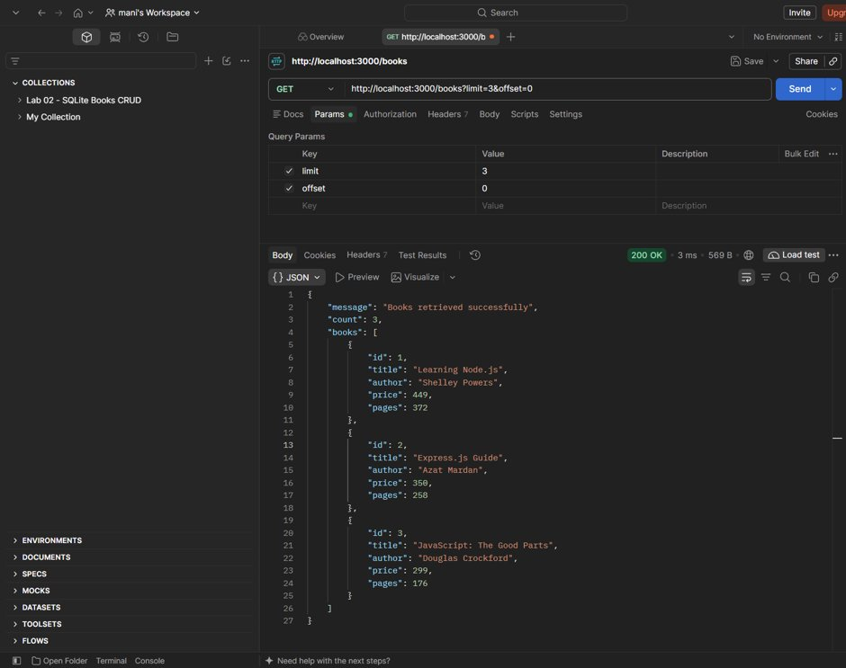](screenshots/pagination-limit-3-offset-0.png)

---

### 6. Invalid Query Parameter Validation (`GET /books?order_by=rating`)
- **Request URL:** `http://localhost:3000/books?order_by=rating`
- **Method:** `GET`
- **Status:** `400 Bad Request`
- **Response:** `{"message": "Invalid order_by value. Allowed: id, title, author, price, pages"}`
- **Description:** Demonstrates allowlist protection rejecting unapproved SQL column names.

[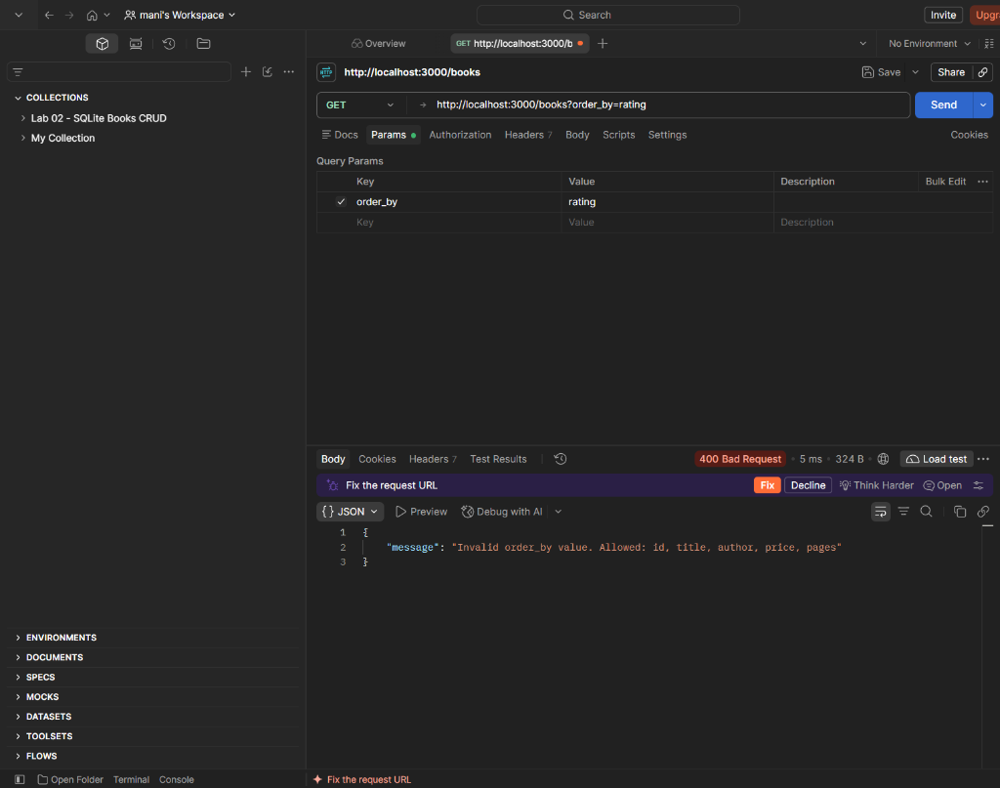](screenshots/invalid-query-param.png)

---

### 7. POST Body Validation: Missing Title (`POST /books`)
- **Request URL:** `http://localhost:3000/books`
- **Method:** `POST`
- **Payload:** `{"author": "Naga Manikanta", "price": 499, "pages": 300}`
- **Status:** `400 Bad Request`
- **Response:** `{"message": "Title is required", "errors": ["Title is required"]}`

[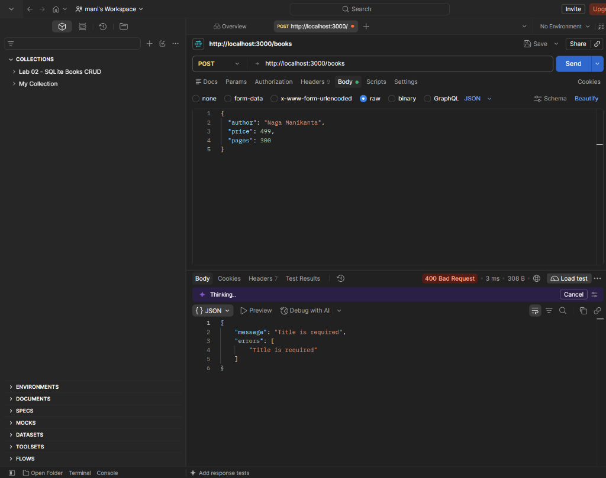](screenshots/post-missing-title.png)

---

### 8. POST Body Validation: Invalid Price Type (`POST /books`)
- **Request URL:** `http://localhost:3000/books`
- **Method:** `POST`
- **Payload:** `{"title": "REST API Testing", "author": "Naga Manikanta", "price": "abc", "pages": 300}`
- **Status:** `400 Bad Request`
- **Response:** `{"message": "Price must be a number", "errors": ["Price must be a number"]}`

[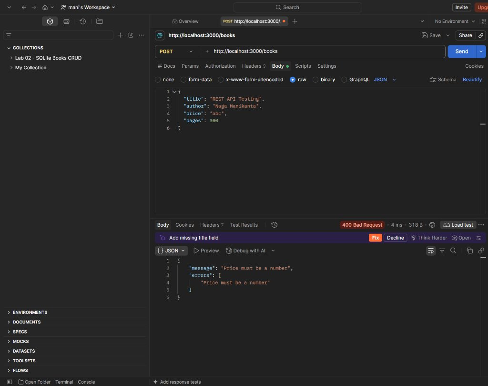](screenshots/post-invalid-price.png)

---

### 9. Lookup Non-Existent Book ID (`GET /books/999`)
- **Request URL:** `http://localhost:3000/books/999`
- **Method:** `GET`
- **Status:** `404 Not Found`
- **Response:** `{"message": "Book with ID 999 not found"}`

[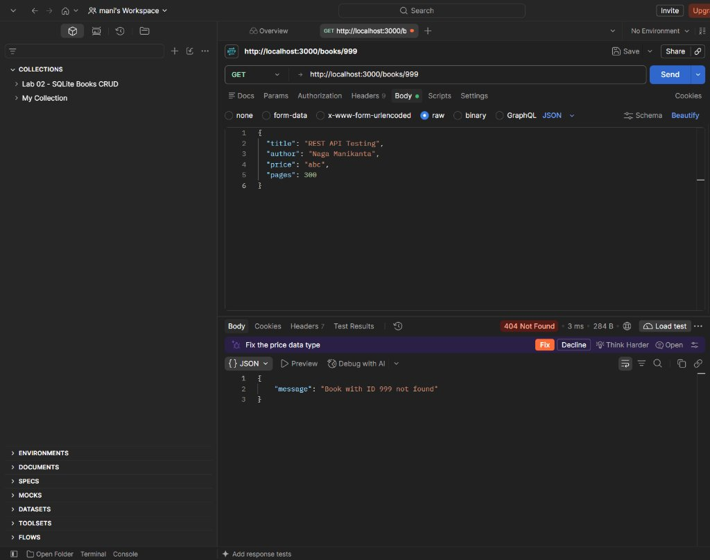](screenshots/get-book-not-found.png)

---

### 10. POST Create Book (`POST /books`)
- **Request URL:** `http://localhost:3000/books`
- **Method:** `POST`
- **Payload:**
  ```json
  {
    "title": "Backend Development Guide",
    "author": "Naga Manikanta",
    "price": 499,
    "pages": 300
  }
  ```
- **Status:** `201 Created`
- **Response:** Returns `{"message": "Book created successfully", "book": { "id": 14, ... }}`

[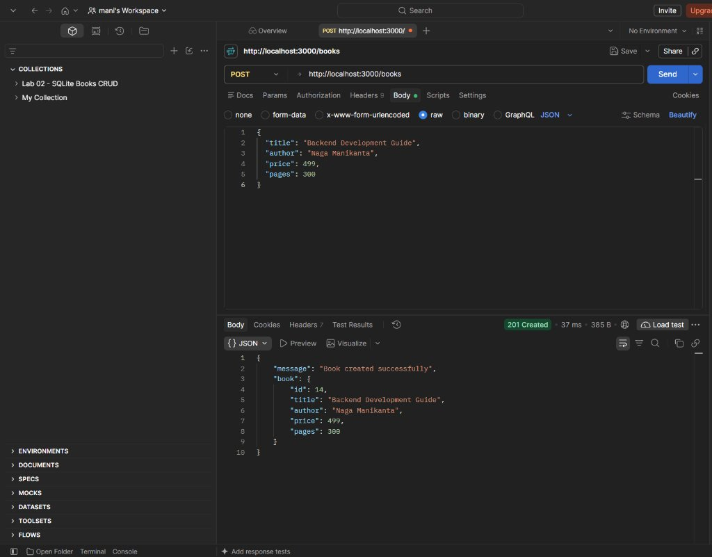](screenshots/post-create-book.png)

---

### 11. DELETE Book (`DELETE /books/1`)
- **Request URL:** `http://localhost:3000/books/1`
- **Method:** `DELETE`
- **Status:** `200 OK`
- **Response:** Returns `{"message": "Book deleted successfully", "book": { "id": 1, ... }}`

[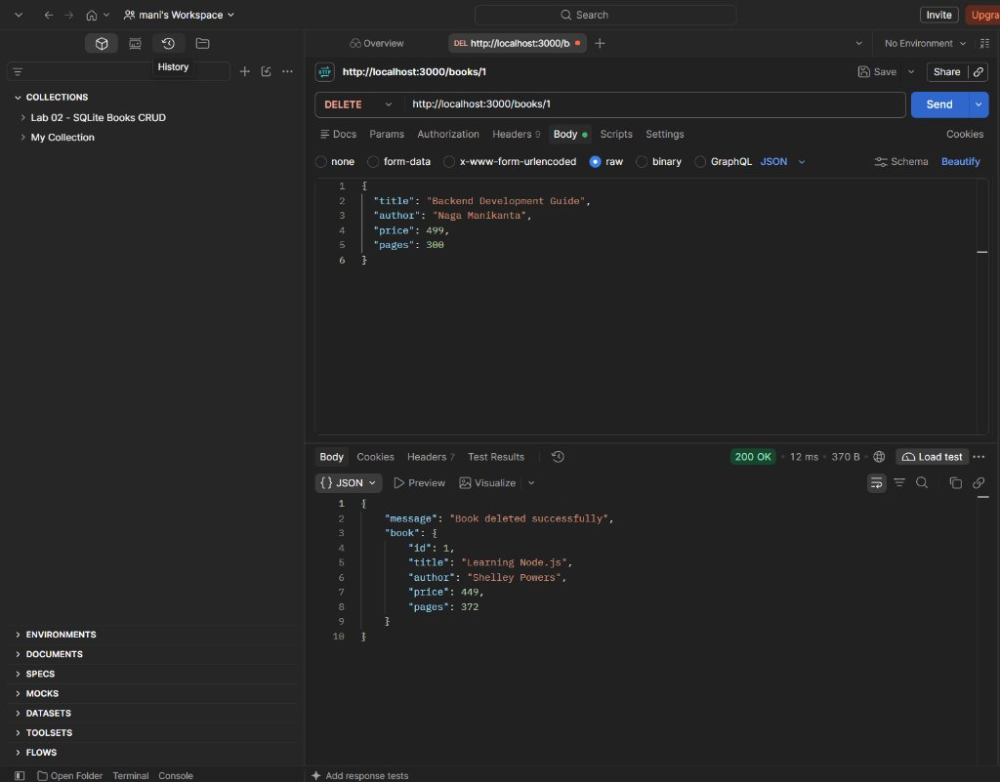](screenshots/delete-book.png)

---

## Problems Faced and Solutions

| # | Challenge Encountered | Root Cause | Solution Implemented |
|:---:|---|---|---|
| **1** | **SQL Injection via `ORDER BY`** | Unlike `WHERE` clause parameters, column names in `ORDER BY` cannot use SQL parameterized placeholders (`?`). | Implemented a strict in-memory column allowlist (`['id', 'title', 'author', 'price', 'pages']`). If the user specifies any other column, the API immediately halts execution and returns HTTP `400 Bad Request`. |
| **2** | **Accidental Duplication of Seed Data on Restart** | Using standard `INSERT` scripts can insert duplicate records each time nodemon or Node restarts. | Implemented a pre-seed database check `SELECT COUNT(*) AS count FROM books`. Seed insertion statements are only executed if `count === 0`, ensuring full idempotency. |
| **3** | **Handling Missing vs Nullable Payload Attributes** | In JavaScript, distinguishing between optional parameters (`pages`) and omitted mandatory attributes (`title`, `author`, `price`) can trigger runtime errors. | Created a centralized validation function `validateBookBody()` that systematically verifies presence, data types, and logical boundaries before SQL generation. |
| **4** | **Query Parameter String Coercion** | Query parameters parsed by Express (`req.query`) arrive as strings (e.g. `'300'`), causing subtle bugs with numeric comparison logic. | Applied strict parsing functions (`parseFloat()`, `parseInt(..., 10)`) paired with `isNaN()` boundary checks before adding values to SQL parameter arrays. |
| **5** | **Git Inadvertently Tracking SQLite Binary Database** | Binary `.db` files cause git merge conflicts and repository bloat. | Configured `lab-03/.gitignore` to ignore `*.db`, ensuring the database file is cleanly generated on-demand at application startup. |

---

## Conclusion

**Lab 3** successfully establishes a production-grade, extensible REST API architecture using Node.js, Express, and SQLite. The service demonstrates end-to-end best practices including secure parameterized query generation, defensive input validation, standardized RFC HTTP status codes, structured error handling, and robust data persistence. All 11 operational scenarios and error states have been tested and verified through Postman.

---

## License

ISC License © 2026 Naga Manikanta Addaguri. Developed for educational laboratory assessment at Aurora.
